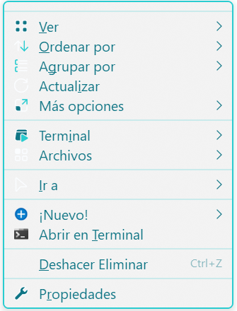

# Nilesoft Shell - Configuración Personalizada

Configuración moderna y minimalista para Nilesoft Shell con tema cyan/turquesa.

## 🎨 Paleta de Colores

- **Principal**: `#29CCD0` - Cyan vibrante
- **Oscuro**: `#0F7585` - Teal profundo
- **Claro**: `#FBFDFF` - Blanco suave
- **Acento** (opcional): `#FF4368` - Rosa/rojo

## 🖼️ Vistas Previas

| Preview | Dark |
| :---: | :---: |
|  |  |
|  |  |
|  |  |

## 📁 Estructura de Archivos

```
E:\Assets\Themes\NilesoftShell\
├── imports/
│   ├── theme.nss          # Tema visual
│   ├── images.nss         # Configuración de iconos
│   ├── modify.nss         # Modificaciones de menús del sistema
│   ├── remove.nss         # Items removidos del menú contextual
│   ├── terminal.nss       # Terminales y herramientas CLI
│   ├── file-manage.nss    # Gestión de archivos
│   ├── develop.nss        # Herramientas de desarrollo
│   ├── goto.nss           # Rutas rápidas
│   └── taskbar.nss        # Menú de barra de tareas
└── shell.nss              # Archivo principal
```

## ✨ Características

### VS Code Inteligente
- Aparece solo en archivos editables (código, texto, configs)
- Opción para abrir carpetas completas
- Iconos nativos de la aplicación

### Terminales Disponibles
- Command Prompt
- PowerShell
- Windows Terminal
- Warp
- Wave
- Neovim
- MySQL Shell

**Tip**: Mantén presionado `SHIFT` para ejecutar como administrador

### Menú "Abrir con"
Apps configuradas:
- Visual Studio Code
- Affinity Suite (Designer, Photo, Publisher)
- Krita
- Bloc de notas

### Rutas Rápidas Personalizadas
```
E:\Descargas
E:\Documentos
E:\Imágenes
E:\Música
E:\Vídeos
E:\Proyectos
```

### Aplicaciones en Taskbar
- Paint, Edge, Calculator, Regedit
- Affinity Suite
- Gestión de ventanas
- Acceso rápido a configuración

## 🚀 Instalación

1. Copia toda la carpeta a `E:\Assets\Themes\NilesoftShell\`
2. Edita `C:\Program Files\Nilesoft Shell\shell.nss` y agrega:
   ```neshell
   import 'E:\Assets\Themes\NilesoftShell\shell.nss'
   ```
3. Reinicia el shell:
   ```cmd
   "C:\Program Files\Nilesoft Shell\shell.exe" -restart
   ```

## ⚙️ Configuración

### Ajustar Rutas Personales
Edita `imports/goto.nss` y cambia las rutas según tu sistema.

### Agregar Extensiones a VS Code
Edita `shell.nss` en la línea del `str.equals`:
```neshell
str.equals(sel.file.ext, ['txt','md','json',...])
```

### Cambiar Colores del Tema
Edita `imports/theme.nss` y ajusta los valores hexadecimales.

## 🎯 Shortcuts

- `Click derecho` en archivo → Menú contextual completo
- `SHIFT + Click derecho` → Ejecutar como admin (terminales)
- `Click derecho` en taskbar → Menú de aplicaciones rápidas
- `SHIFT + Click derecho` en taskbar → Info de Nilesoft Shell

## 🔧 Personalización Avanzada

### Ocultar Items del Sistema
Agrega en `imports/modify.nss`:
```neshell
modify(where=str.contains(this.title, "Nombre") vis=vis.remove)
```

### Agregar Apps a "Abrir con"
Edita `imports/open-with.nss`:
```neshell
item(title='Mi App' cmd='miapp.exe' args='"@sel.path"')
```

## 📝 Notas

- Todos los paths usan formato Windows con `\`
- Las variables `@sys.bin`, `@sys.prog` son rutas del sistema
- `inherit` en `image` usa el icono por defecto de Windows
- Los iconos personalizados requieren ruta completa al `.exe`

## 🐛 Troubleshooting

**El menú no carga:**
- Verifica las rutas en `shell.nss`
- Revisa la sintaxis de los archivos `.nss`
- Ejecuta `shell.exe -restart` como admin

**Los iconos no aparecen:**
- Asegúrate de usar rutas completas en el parámetro `image`
- Verifica que las aplicaciones estén instaladas
- Usa `inherit` si no tienes la ruta exacta

**VS Code no abre:**
- Verifica que `code` esté en el PATH
- Prueba con la ruta completa: `C:\Users\...\Code.exe`

## 📄 Licencia

Configuración personal basada en [Nilesoft Shell](https://nilesoft.org/)

---

**Autor**: Biglex J  
**GitHub**: [github.com/biglexj](https://github.com/biglexj)  
**Web**: [biglexj.com](https://biglexj.com)